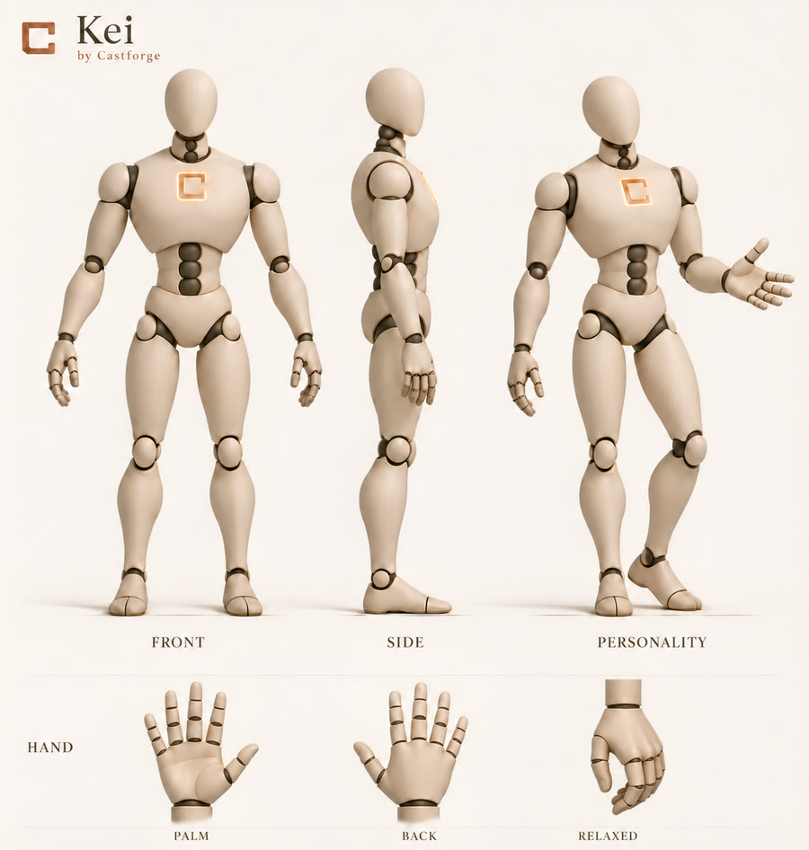
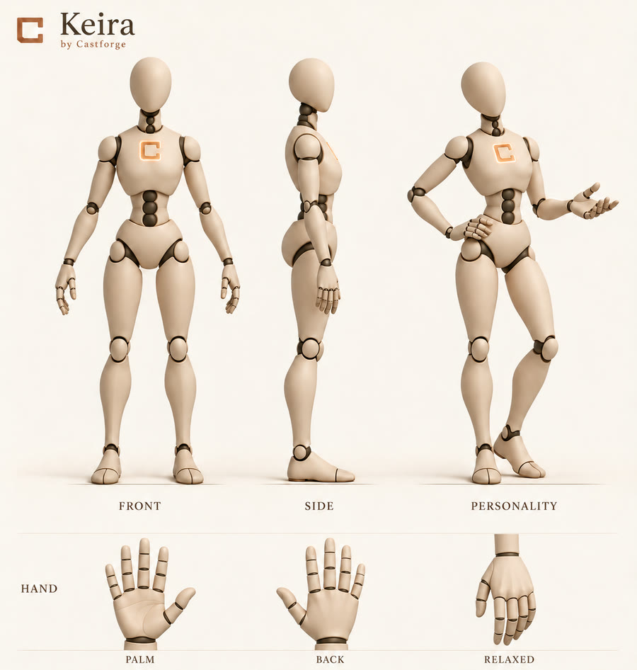
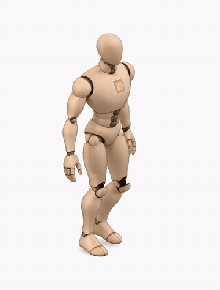
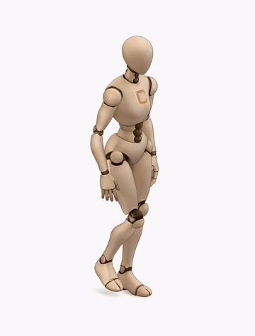

# Kei Animator, by Castforge

**An animation agent that works like a classically trained animator.**

Kei keys every motion by hand, from animation principles and body mechanics. It does not import or retarget motion-capture
clips to make a shot, and it ships no motion library. Some rules use measurements taken from reference footage and
published research. It works beside an animator as a colleague: it plans before it keys, it shows its work at every stage, a
separate reviewer checks every pass, and a person signs off every shot.

Kei Animator is the tool; Kei is the agent inside it, and `kei` is its command. Kei reads as "key", as in key poses. The method it follows is open, and it is called the Kei method.

Short guides live in [docs/](docs/README.md): a quickstart, the stages, the file formats with their JSON Schemas,
engines and troubleshooting by status. This README is the full reference.

## Quickstart

    pipx install kei-animator        # or: uv tool install kei-animator
    kei doctor                       # checks Python, the rule book, your agent CLIs, ffmpeg
    kei demo                         # Kei's tools on an approved walk, offline, in about a minute
    kei skill install                # the Kei skill for Claude Code (--agent codex for Codex)
    kei init                         # writes kei.toml in the folder where your shots will live
    kei run my_shot --request "a tired character climbs three steps and sits down"

`kei demo` needs no agent and no subscription: it renders a finished walk, runs the body checks, the pose records,
the trails and the four-view video, and prints where each file is. A real shot runs twelve stages with your agent
and its reviewers, and takes from 30 to 90 minutes for a short action to several hours for a long one; the heavy
lift benchmark took 8 to 13 hours unattended. "First ten minutes" below goes through each step.

## What a shot looks like

You ask for a shot in plain words: "a tired character climbs three steps and sits down". Kei runs it through the same
twelve stages a trained animator would, and every stage leaves a file you can open:

| Stage | What it leaves |
|---|---|
| 1. Brief | the request restated, the idea sentence, the character, the topics this shot needs |
| 2. Rig evaluation | what the rig can do and where its limits are |
| 3. Weight evaluation | the character's mass and weight class |
| 4. Understanding score | how well the action is understood before any key |
| 5. Reference search | vetted reference for the action |
| 6. Study | the reference measured, and where the shot departs from it |
| 7. Plan | the key poses with their frames, drawn as a plan sheet (side view, plus front and top views when planned), and the planned arcs |
| 8. Blocking | the key poses, stepped, in four views and a playback, with a record of each key pose (support, weight side, centre of mass, lean, what the hands hold) and a pose sheet the critics read |
| 9. Breakdowns, spline and polish | each refined pass in its own folder |
| 10. All the checks | contacts, foot slide, balance, joint ranges, arcs, the twelve principles, basic posing (an A-frame stance, locked knees, a kinked neck, a dead straight arm, a body that does not move) and the objects the character handles, measured by `kei check`; `kei check <shot> <pass> --explain <flag>` prints one flag's measure, frames, value and limits |
| 11. Self-review | what was seen, frame by frame, before anyone else looks |
| 12. Delivery | the shot, and the lessons it taught |

No stage is ever skipped, on any shot, however small.

## How it stays honest

- **Plan first.** Kei cannot key a pose before its plan sheet exists and has passed review.
- **Never its own judge.** A separate agent reviews the plan, the blocking and every refined pass, checking each against
  the plan sheet. Any agent command line can be a reviewer, and several can review at once; one send-back is enough.
  Each reviewer sees the stage's earlier send-backs, so it does not reverse an earlier note without saying so. A
  send-back names a fault in the motion or a failed check; a missing record is a note for the animator, never a send-back.
- **Gates at every stage.** A stage counts as done only when its file exists and its checks hold.
- **Loops in place.** A loop is made in place unless you ask for root motion: the body stays on its spot and each
  planted foot slides back at the walking speed, as a game plays it while the engine moves the character. The shot
  records that speed (`"in_place": {"speed_mps": 1.4}`), and `kei check` adds the travel back before it measures, so
  a skating foot is still caught.
- **Sources in its own words.** Kei cites research and footage by author and year and says what each source shows in
  its own words, quoting at most one sentence. The rules are written in Kei's own words, and a private record traces where each one came from.
  A number it did not read in the source during the shot carries `(unchecked)`, and the live page marks those rows.
  To hold it to that, keep a private list of the names you never want in a shot, one pattern per line, in
  `kei.banned.txt` next to kei.toml (or set `[book] banned_names`). A stage whose files name one fails; the note
  gives the file and the line, never the name. Kei ships no list, and git ignores `kei.banned.txt`. These are writing
  rules, not a legal clearance: there is no quotation length that guarantees permission, and rewording does not by
  itself make a source's examples or arrangement free to use. Use only material you have the right to use.
- **Web access, asked once.** `kei init` asks one question: may Kei's agents search the web for references? The
  answer is saved as `[seats] web` in kei.toml (a kei.toml from before the question is asked at its next
  `kei run`; with nobody at a terminal, the answer is on). On, a Claude Code seat gets WebSearch and WebFetch, and a
  Codex seat gets `--search`; the agents read papers and link clips at a timestamp, never downloading them. Off, both
  are refused. `kei init --web on|off` answers in advance, and `kei settings set seats.web off` changes it later.
- **Real footage from your own library.** Kei's agents never download clips. Give them a
  folder of footage you have the right to use, such as public-domain photo sequences or clips under an open licence,
  with an `INDEX.md` and a `SOURCE.md` per clip (creator, year, licence, frame rate, view). Put it in `kei-refs`
  next to kei.toml, or set `[refs] library`. Kei gives its agents read access to it, and the reference stage takes
  its short look there: frames pulled into the shot's own `.kei/look/` folder, measured, never traced, and no clip
  copied into the shot. Kei ships no footage.
- **Motion capture you may use, as measured reference.** `kei ref import <shot> <file.bvh> --licence "CC0" --source
  <url>` reads a BVH capture (CMU, Mixamo, Rokoko and most others name their joints in a way Kei matches) or a C3D
  of skin markers (the Plug-in Gait set and its CMU variant: Kei estimates the joint centres inside the markers, the
  hips by Bell's regression, so they are within a few centimetres), turns it into Kei's joints, and writes `refs/mocap/<name>/`: the joints per frame, what `kei check` measures on it, the
  pelvis bob, the travel and speed, each foot's contact frames, a sheet of eight frames, the source and licence as you
  stated them, and a row for `REFS.md`. The plan measures against it; the keys are never traced from it. Kei refuses a
  file with no licence. A C3D with another marker set is refused by name: convert it to BVH in your capture tool.
- **A person signs off.** A finished shot waits for your approval. A note you give sends it back, and becomes a lesson.
  A note after you approved withdraws the approval and opens the shot again.

## Running a shot

    kei run <shot> --request "a tired character climbs three steps and sits down"
    kei status <shot>

`kei run` takes the shot through the stages until it is done or needs a person, and `kei status` says where it
stands. A shot stops for a person in these cases:

- **The gate or the critics refused the stage too many times.** Read the notes `kei status` prints, fix what needs
  fixing, then `kei retry <shot>`. The next try reads the critics' last notes again. Add your own with
  `kei retry <shot> --note "keep the contacts, lift the passings"`: that note is an instruction for the animator,
  and the critics do not judge the work against it. To run without stopping here, set `limits.on_send_back_limit`:
  `retry` runs the stage again with `limits.retry_note`, up to `limits.auto_retries` times, and `advance` moves the
  critics' open notes to your sign-off checklist and goes on.
- **A stage or a critic asks you something.** Any stage, and any critic, can ask a question only a person can settle,
  such as an unclear brief or a viewing at real rate (no agent can watch a video at its frame rate). The shot stops
  with `needs_answer`, and `kei status` prints the question and the file to look at, for example the ten-loop video
  `out_blocking/blocking_x10.mp4` that `kei render` writes for every loop. Reply with `kei answer <shot> --text
  "watched ten loops at 24 fps: the seam does not hitch"`, then `kei run <shot>`. The animator and the critics both
  read your answer on the next try, and the critics take a recorded viewing as meeting the rules that ask for one.
- **A critic leaves a check for your sign-off.** A critic may mark a check "author viewing at sign-off" instead of
  asking now. A critic's later review of the same stage replaces the checks it left there before, and the same check
  is listed once. When the shot reaches `needs_approval`, `kei status` lists those checks before you approve, and
  `kei approve` run inside the shot folder signs it off.
- **A seat hit a usage or rate limit, or could not start.** The stage pauses (status `paused_usage` or
  `paused_machine`), and the pause is not counted as a try. A critic that crashes, times out or gives no verdict is
  asked once more, then pauses the stage the same way: it never costs a send-back. `kei status` says why in plain words. When the limit
  resets or the machine is ready, `kei run <shot>` goes on where it stopped; the request is already recorded. A pause
  during the review resumes at the review, without running the animator again.

For a run with nobody at the keyboard, `kei run <shot> --answers answers.toml` answers plain questions from a file
(`default = "..."` and `[[answer]]` tables with a `match` pattern and a `text`) and goes on, recording each answer as
read from the file. A choice only a person makes (where to animate in Maya or Unreal, an imported character's fit)
still stops.
`kei run <shot> --wait-on-limit` waits out a usage limit instead of stopping: Kei reads the reset time from the
seat's message (else waits 30 minutes), records it in the history, and runs on, for at most `--max-wait-hours` (12).
The critics of a stage answer at the same time, and when one pauses, the verdicts the others gave are kept for the
resume. A critic with a `fallback_cmd` in kei.toml hands its review to that stand-in seat when it hits a usage limit,
so the stage goes on.

For scripts, `kei status <shot> --json` prints the shot as JSON, and the exit code says where a run stopped. Errors
go to stderr, starting with `kei: `; everything else goes to stdout.

| Exit code | Meaning |
|---|---|
| 0 | done, or the command did what it was asked |
| 1 | an error (the message is on stderr) |
| 2 | the shot needs a person: `kei status` says why |
| 3 | the shot needs an answer: `kei answer` |
| 4 | the shot waits for your approval: `kei approve`, or `kei note` |
| 5 | paused (a usage limit, a seat fault): run `kei run` again to go on |

## A delivered shot's folder

When you approve a shot (`kei approve`), Kei tidies its folder, whatever app the keys live in. On top stay only the
finished files: the delivery videos, `REVIEW.md` (what was delivered and what Kei learned), `GROWTH.md`, any exported
model, `<shot>_final.json`, the approved pass, and `<shot>_report.html`, the live page saved as one file: open it in
any browser, with no server and nothing loaded from the network, to see the shot's stages, poses, notes, references
and renders, read from the folder beside it. The work behind them moves under `production/`, one folder per
phase in the order it was done: `1_setup`, `2_planning`, `3_blocking`, `4_breakdowns`, `5_spline`, `6_polish`,
`7_checks`, `8_review` and `9_probes` (the rig probes and tests), plus `other` for anything else. Each pass goes to
the phase its gate in GATES.md names.

Every move is recorded in `.kei/layout.json`. A command that needs the work puts it back first: `kei note` reopens the
shot with every file where the stages expect it, and `kei export` or `kei render` on a delivered shot puts the files
back, does its job, and tidies the folder again. `kei status` and the live page read the tidy folder as it is.

An Unreal shot is tidied in the editor too: Kei's folder `/Game/Kei/<shot>/` keeps on top only the delivered sequence
(and the baked animation), and every other sequence Kei made moves to `Production/<phase>/` beside it. Kei moves only
its own assets, deletes nothing, and records each new path. With the editor closed at sign-off, run
`kei unreal tidy <shot>` later. A copy of the shot's report goes beside the Unreal assets too
(`Content/Kei/<shot>/<shot>_report.html`); its images and videos point back at the shot folder by full path, so that
copy works on this machine only.

## Watching a shot live

`kei run` opens the shot's live page in your browser and prints its link (`live page: http://127.0.0.1:...`). The page
follows the shot while Kei works and updates every second:

- **Where the shot is.** The twelve stages down the side, with the time and the tries each took, and the stage
  working now in plain words.
- **The key poses.** Each key of the plan drawn on a light table, with its line of action and centre of mass, its
  front or top view, and the plan's note. Play the keys at the shot's frame rate (or half or a quarter), step through them with the arrow
  keys, and pick an earlier try of the plan to compare: the try before shows in blue under the current one, and a
  dot marks each pose redrawn since.
- **What the critics said.** The notes of the last send-back, by critic, each with the frames it names. The frames
  are marked on the timeline, and a click shows the nearest key.
- **What happened.** Every try, answer and verdict, newest first. A question waiting for you shows at the top, with
  the `kei answer` command to copy.
- **References, renders and sheets.** The references with Kei's verdict on each, each pass with its video and
  frames, and every sheet Kei drew.

The page reads the shot folder and changes nothing in it. It keeps a copy of each new `plan/plan.json` in
`.kei/live/plans/`, to compare the tries. It runs in its own process on 127.0.0.1, with the same checks as the
review page (a private link, a session cookie, nothing loaded from the network). It stops after two hours with
no change and no page open, or a quarter of an hour after the shot is signed off. Run `kei run` again, or
`kei live <shot>`, to bring it back.

Turn it off in kei.toml with `[live] page = "off"`, or keep it and stop the browser opening with `open = "off"`
(`kei settings set live.page off` does the same).

## Objects, pose records and the probe

Kei does the repeatable work around the poses, so the agent does not write it again on every shot:

- **Objects.** A pass's shot.json lists the objects the character handles (`"objects"`: a box, cylinder or sphere
  with its size, rest place and `attach` frames to `hand_l`, `hand_r`, `hands` or `floor`). Kei places each object on
  every frame from the hands, draws it in every render (the stick figure as an outline, the four-view `--post` video
  with a contact shadow), and `kei check` flags one under the ground, one floating with nothing holding it, and a
  hand that takes it from a distance. `"yaw_deg"` sets its heading, and `"turn": "hands"` turns it with the line
  between the palms while both hands hold it.
- **Pose records.** `kei poses <shot> <pass>` writes `out_<pass>/poses/poses.json`: for each key pose of the plan,
  the agent's function, kind, intent and judging view, with the planted feet, weight side, centre of mass against
  the support, lean and held objects measured by Kei. `pose_sheet.png` draws each key in four views with those
  facts. Kei writes both before every blocking and passes review.
- **Probe.** `kei probe <shot> <pass> --frames 140-155 --joints elbow_l,hand_l,com` prints the bends, positions,
  moves, speed (m/s), acceleration (g) and foot contacts frame by frame (`--json` saves them). It also reads
  `com_margin` (how far the centre of mass is outside the support), `ch:<channel>` (a rig channel's value),
  `palm_gap:<object>` (each palm's gap to an object) and `<joint>@<joint>` (one joint's offset from another). It
  reads only.
- **Trails, curves and onion skins.** `kei trails <shot> p5 p6 --parts hand_l_tip` draws part paths with a dot per
  frame, passes overlaid; `kei curves <shot> p6 --channels spine,armL` draws a curve image per channel; `kei render
  <shot> p6 --style stick --onion 2` draws the frames around each frame as pale figures.
- **Pinned render settings.** A `render.json` in the shot folder pins how each stage renders, so every render of it
  looks the same: `{"all": {"size": 270}, "blocking": {"style": "stick"}, "p6": {"onion": 2}}` (settings: style,
  camera, size, emission, overlay, onion, mode). The pass's own entry wins over its stage's, the stage's over `all`,
  and a flag on the command line over all of them. Pose sheets hold ten keys a page (`pose_sheet.png`,
  `pose_sheet_2.png`...).
- **IK and FK switching, matched.** An arm is FK (armL, elbowL) with IK blended in by `ikL` [x, y, z, weight];
  `poleL` [x, y, z, weight] aims the IK elbow at a world point. A leg is IK on its foot target, and `legFKL` [pitch,
  roll, twist, knee, weight] blends in an FK leg swung from the pelvis (the foot keeps its own pitch, yaw and roll).
  All are off by default, so a shot without them plays as before. `kei keys <shot> <pass> match --frame 40 --channel
  armL --value ik` switches with no snap: the frame before holds the old mode, and frame 40 keys the new mode fitted
  to the same pose (within 2 mm; it refuses when no pose of the new mode gets there). It works both ways, for armL,
  armR, legL and legR. In Maya, the IK and the FK controls are both keyed on the solved pose, and each limb's ikFk
  follows these weights. In Unreal, `kei unreal switch <shot> <pass> --limb arm_l --to ik --frame 40` does the same on
  the Control Rig's own `<limb>_fk_ik_switch` (true is IK): the open editor places the new mode's controls where the
  limb's bones are and measures the switch, and Kei writes it into the pass only when it moves no bone more than
  0.5 cm. The frame before keeps the old mode, its controls pinned as they played. Then `kei unreal key`. Tested live
  on the mannequin's CR_Mannequin_Body in Unreal 5.8: both arms and a leg, both ways, 0.0 cm at the switch.
- **Try and sweep.** `kei try <shot> <pass> set --frame 40 --channel spine --value 0.1,0,0` makes a `kei keys` edit on
  a copy and prints the flags it removes and adds; `kei sweep <shot> <pass> --frame 40 --channel spine --from 0 --to
  0.3 --steps 7` does it for a range of values and marks the one with the fewest flags. The shot is never changed.

## Seeing a shot

`kei render <shot> <pass>` draws a pass on the shot's character in five views, with a still per key, a key sheet
and a playback video; a loop also gets `<name>_x10.mp4`, the loop played ten times at its frame rate. Two cameras
help with travelling shots such as walks:

- `--camera follow` rides the shot's even travel, so the character stays in frame while ground marks scroll under
  it. The marks are spaced to repeat exactly over one cycle, so the loop's seam shows no jump.
- `--camera delivery` renders through the locked delivery camera the plan names in `plan/plan.json` ("camera": yaw,
  pitch, target, lens and distance or a frame height, aspect, follow), in one panel at the camera's aspect.
  The camera can move: `"keys": [{"f": 0}, {"f": 40, "lens_mm": 70}, {"f": 72, "yaw_deg": 60, "cut": true}]` pushes
  in from frame 0 to 40 and cuts to a new angle at 72. Each key changes some settings (yaw, pitch, target, lens,
  distance, frame height) from its frame; between keys the camera eases, and a key with `"cut": true` starts a new
  setup on its frame. The render writes `framing.json` beside the frames and prints its staging notes, per setup:
  frames where part of the character leaves the picture, a setup under 8 frames, a cut that crosses the line (from
  the character's right side to its left), and a setup where the character fills under a quarter of the picture.
  These are notes for the animator and the critics, not a gate.

The character is drawn smooth, with blended edges, at 540 pixels a panel unless you pass `--size`. To share a shot,
`--post` writes a clean video: the side, three quarter, front and back views two by two, 1080 by 1080, with no
label, border or ground mark, in H.264. `--out <folder>` puts it somewhere other than the pass's own folder.

## A person signs off

Every shot ends with a person. When a shot reaches `needs_approval`, open it on the review page:

    kei review <shot>

Kei draws the latest pass in four views (side, three quarter, front, back), one picture per frame, and opens a page
in your browser. The page runs on your machine only: it answers on `127.0.0.1`, with a key in the address Kei
prints, and loads nothing from the internet. `--no-browser` prints the address without opening it; `--size` sets the
pixels per view (360 by default). `kei review` with no shot lists the shots under the current folder that wait for
you.

On the page:

- **Before and after**, side by side and always labelled. After is the newest pass. Before is the round you looked
  at last, so you see what changed since your last note; on the first round it is the blocking pass.
- **Play** runs at the shot's own frame rate, from frame times. **Play x10** plays ten loops and counts them. Step
  one frame at a time with the buttons or the Left and Right arrow keys (the first press pauses the play; before and
  after stay on the same frame, and a cycle wraps at its seam), or drag the bar to any frame. The frame number is on
  screen. The arrow keys do nothing while you type in the note.
- **The pen** draws on any frame of any view. The drawn frames are listed, and you can clear a frame.
- **The checklist** ("3 things to check by eye", closed until you open it) shows only the checks the critics left
  about the pass on screen, in plain words. Two critics asking the same thing are one item. A video or a frame the
  check names is a button that plays it or jumps to that frame; the rule IDs and the critics' names are in small
  text. Checks about older passes stay in the shot's state file and are not shown; `kei status` lists the same short
  list. Accept waits until every item is ticked, and only you tick them.

The page opens on **one question at a time**. The shot loops in its four views over the frames the question names,
and the question sits under it, written plainly ("Frame 13-18: the left hand's arc looks off"). Press Y for yes or N
for no, or click; Left and Right still step frames. A no needs a reason: a short note or a pen stroke on the frame,
and your words go to the shot as you typed them. A yes only passes that one check. After the last question, one line
sums up your answers: with every answer yes, a separate **Approve the shot** button signs it off (answering yes never
does); with a no, **Send it back with my notes** sends the shot back to a stage with your notes. **See everything**
opens the full page described below, and a shared lesson opens the same way, as one question: yes accepts it, no
rejects it, or needs work, then a separate button writes the verdict.

The critics write every check they leave for you in that plain form, the frames first and 12 words at most, with no
rule ID, file name or critic name; Kei asks a critic again when a check is written any other way.

On the full page, one of three buttons:

- **Accept** closes the shot, as `kei approve` does. Only you can do this: the page never approves on its own, and an
  old page cannot accept a newer round.
- **Needs work** sends the shot back to a stage (passes by default) with your words, kept exactly as you wrote them,
  and your drawings. Your words become a local lesson, as with `kei note`, and the next try of that stage is told to
  look at each drawing. Tick "a rule for every shot" (on a question card: the box, or the E key) when the note is
  about the craft and not only this shot; `kei note --every-shot` does the same. A note is for this shot unless you
  say so.
- **Reject** stops the shot with your reason. Tick "keep the reason as a lesson" only when the reason is about the
  craft; a wrong brief is not a lesson. `kei note` opens a rejected shot again.

`kei approve` and `kei note` still work from the command line; they do exactly what the buttons do.

## Settings

Kei reads its settings from `kei.toml` in the folder you run it from (start from `kei.example.toml`). You can change
them without opening the file:

    kei settings                              # every setting, its value, where it comes from, what it means
    kei settings share.mode                   # one setting, with its longer help
    kei settings set share.mode always
    kei settings set animator.timeout_s 2400
    kei settings set "critics[codex].cmd" '["codex", "exec", "-"]'
    kei settings unset limits.max_attempts    # back to the default
    kei settings add-critic second --preset codex
    kei settings remove-critic second
    kei settings set share.repo my-studio/kei-lessons   # where shared lessons go (owner/name)
    kei settings set share.mode auto          # share with no dialog; prints where lessons go and if that is public

A value is read as TOML (`3`, `"ask"`, `["claude", "-p"]`); a plain word is fine for a text setting. Before it
saves, Kei checks the new file the way a shot reads it: a bad value, an agent program that is not on your PATH, a
missing rule book, no critic left, or anything that looks like an API key is refused, and the file stays as it was.
A saved change keeps every comment in the file and the old file as `kei.toml.bak`, and it applies from the next
`kei run`. With no `kei.toml` yet, the first change copies `kei.example.toml` here, comments included.

The review page (`kei review`) has a Settings tab with the same list and the same checks. A refusal shows next to
its field. A change to an agent's command line is shown in full, old and new, and saved only after you confirm it;
"Test this seat" runs the program with `--version` for up to ten seconds. If the file changed since the tab loaded
it, Save asks you to reload first. The tab can switch automatic sharing off, but never on and never to another
repository: that is done with `kei settings` or in `kei.toml`, so you always see where your lessons will go.

## Seats and privacy

**Your AI agents send data to their providers.** Kei runs locally, but the agents it runs as seats (Claude Code,
Codex or any other) may send prompts, rule text, lessons, file contents, images and tool results to their service
providers. That happens during ordinary animation, not only when you share a lesson. Training use, retention and
where it is processed depend on your provider, your account and its settings. Use only material you are allowed to
process with those services, and ask your employer or client before you use work material.

Kei runs your own agent command lines as its seats: one animator and one or more critics, set in `kei.toml` (start
from `kei.example.toml`). A seat started the normal way loads your personal setup: your global instructions, your
saved memory, your skills and your connected tools. Whatever it loads can end up written into the shot's files. The
example config isolates each seat as far as the installed command lines allow:

| Seat | Flags | What they keep out |
|---|---|---|
| Claude Code | `--safe-mode` | CLAUDE.md files, saved memory, skills, plugins, hooks, MCP servers, agents, custom commands |
| Claude Code | `--setting-sources project,local` | your user settings file |
| Claude Code | `--strict-mcp-config`, `--disable-slash-commands` | any MCP server not named on the command line; every skill and command |
| Codex | `--ignore-user-config`, `--ignore-rules`, `--ephemeral` | your config file and the MCP servers in it, your rules files, a saved session |

These flags reduce what a seat loads from your personal setup. They do not make a seat offline, and they do not
guarantee that confidential files cannot be read or sent: the animator can read the folder that holds the shot
folder, may run `python`, and inherits your environment variables. The flags depend on the installed command line's
version.

What no flag removes, said plainly:

- **Claude Code still puts the signed-in account's e-mail address in the seat's context.** Only an API key avoids
  that (`--bare` with `ANTHROPIC_API_KEY`), which means the seat no longer runs on your subscription.
- **Codex still lists the skills in your own Codex skills folder.** No `codex exec` flag hides them.

On Windows, the Codex reviewer's read-only sandbox starts only with `-c windows.sandbox="unelevated"`, which the
example configuration already passes.

The animator may run only the commands the stages need: `kei`, `python`, `ffmpeg` and `ffprobe`. Kei puts its own
scripts folder first on each seat's PATH, so those are the `kei` and the `python` of the Kei that runs the shot.

## The rule book

Kei's knowledge is a rule book in plain Markdown, organised by topic: principles every stage needs (timing, spacing,
arcs, weight, contacts, posing, staging, overlap, anticipation, squash and stretch, appeal, the blocking method, the
passes, review, known pitfalls) and subjects a shot picks (locomotion, actions, arms and hands, the body, head and
acting, the character, reference, creatures and effects, game animation). Each rule says which stages it serves, so
every stage gets the rules for its work and nothing else.

The book lives in this repository, in [`kei/book`](kei/book): one file per topic, 25 topics, 924 rules. It ships
with Kei and is the book every shot reads unless you name another one. Each topic file starts with a `kind:` line
(`principle` or `subject`); each rule is a `###` heading with its ID and title, then a `stages:` line.

To use another book, point `book.path` in `kei.toml` at a folder of topic files, or at one Markdown file read as a
single principle topic:

    kei settings set book.path my-studio-book
    kei settings unset book.path              # back to the book that ships with Kei

A path is read from the folder that holds `kei.toml`. `book.max_chars` (default 450000) caps the rule text one stage
may get; a shot whose rules are over it stops for a person instead of sending fewer rules.

The rule book is written to be read by animators, not only by Kei. Every rule states itself in plain words, with the
numbers that make it usable.

## The characters

When you give Kei no character of your own, it animates one of its own evaluation characters: warm ivory figures with
recessed charcoal joints, built to make arcs, weight and balance easy to judge. Each one carries the Castforge C on
its chest, and its glow can be turned off for reviews.

| Kei | Keira |
|---|---|
|  |  |
| The default character: broad shoulders, a deep chest, sturdy limbs. | Narrower shoulders over a wider pelvis, softer tapers. |
|  |  |
| A walk with personality, run through all twelve stages and signed off by its author. | The same brief for Keira, through all twelve stages and signed off. |

How the character art was made: [docs/characters/ART.md](docs/characters/ART.md).

## Your own characters

Kei animates any humanoid (two-legged) model you bring, rigged or not (glTF, GLB or binary FBX):

```
kei import my_hero.fbx --name hero --height 1.80
```

- **No skeleton:** stand the model in an A-pose (arms hanging 15 to 45 degrees from the body). Kei stands it up,
  scales it to the height, finds its joints from its shape and attaches the mesh to its own skeleton: piece by piece
  for a model built of separate parts, with smooth weights where one piece covers several bones.
- **Rigged:** Kei reads the model's skeleton and weights (Unreal mannequin, Mixamo and common bone names). A bone it
  cannot place is yours to map with `--map <model bone>=<kei bone>`.
- **You approve the fit.** Kei draws `fit.png`, the skeleton over the body, and waits: approve it with
  `kei import --confirm --name hero`, or answer the question a shot on it asks.
- `kei characters` lists the characters a shot can use. Imported ones live in `~/.kei/characters` (or the folder
  `KEI_CHARACTERS` names), outside this repository.
- **Skin at a twist.** Kei plays a smooth skin by linear blending, as Maya, Unreal and the game engines do by default,
  so its previews show what ships. A twisting upper arm or forearm then thins (the candy wrap). Set
  `KEI_SKINNING=dual_quaternion` to keep the volume: Kei's renders blend with dual quaternions, its FBX declares that
  skinning, and a Blender shot preserves volume. Engines that blend linearly still thin the twist.
  Models on four legs, with wings or with many legs wait for the general rig.

## Character folders

The rig and weight evaluations are facts about the body, not about the action. Keep each character's shots in a
folder named after the character, and Kei evaluates the body once:

```
my-shots/
  hero/                 the character folder
    CHARACTER.md        the rig and weight evaluation, with the date and a fingerprint of the character's files
    rig_eval/  weight_eval/
    walk/               a shot
    jump_over_box/      another shot
```

- **The first shot evaluates and saves.** When a shot inside a character folder passes its weight stage, its
  evaluation goes into the folder's `CHARACTER.md`.
- **The next shots reuse it.** The rig and weight stages copy the saved section into the shot, and their gates still
  check it. No seat measures the body again, and `kei run` prints which `CHARACTER.md` it reused and from which date.
- **A change to the character starts over.** A new import or a refit changes the fingerprint, so the next shot
  evaluates again and replaces the saved section.
- **Two characters in one shot:** each one with a saved evaluation is reused, and the others are evaluated and saved.
- **A second shot of the same action** (a second walk) is told where the first one's vetted `REFS.md` is. It is a
  draft to vet again for the new shot, never a copy. A line `Action: walk` in `PLAN.md` names the action when the
  request does not.
- A shot outside a character folder evaluates in the shot, as before.
- `kei shots tidy my-shots` lists the moves that put each shot in its character folder (from the `Character:` line
  in `PLAN.md`, else `[shot] character` in the shot's `kei.toml`). Nothing moves until you add `--apply`, and a
  running shot is never moved.
- Moving a shot leaves `GROWTH.md` where it is. The delivery gate finds the shot's entry in the shot folder, beside
  it, or beside its character folder. A shot delivered in a character folder writes its entry to the character
  folder's `GROWTH.md`, the folder its animator seat can reach (`--add-dir ..`).
- A section heading in `CHARACTER.md` may use the short name (`## kei` for `kei_model`) or the display name; the saved
  section always uses the full name.

## First ten minutes

1. Install the `kei` command (Python 3.12 or newer), with `pipx install kei-animator` or `uv tool install kei-animator`.
   Both put `kei` on your PATH. A plain `pip install kei-animator` works too, but `pip install --user` can leave the
   command off your PATH: then run Kei as `python -m kei` (for example `python -m kei init`) or add pip's user scripts
   folder to your PATH. To work on Kei itself, clone this repository and run `pip install -e .` in it.
   Then run `kei doctor`: it checks Python, the config, the rule book, each seat's program and version, ffmpeg, gh
   and Maya when you use it, and says how to fix each problem.
2. Install the Kei skill for your agent: `kei skill install` (Claude Code, every project), `kei skill install --agent
   codex`, or add `--project` to install it inside the current folder. The skill ships in the package, so this works
   after a pipx or uv install too. By hand, copy the folder `skill/kei` of this repository into the agent's skills
   folder:
   - Claude Code: `~/.claude/skills/kei` for every project, or `.claude/skills/kei` inside one project folder.
   - Codex: `~/.agents/skills/kei` for every project (older Codex versions read `~/.codex/skills/kei`), or
     `.agents/skills/kei` inside one project folder.

   Start a new chat after you install it. If your agent does not list the skill, check its own documentation for
   the skills folder of your version: these folders are the ones Claude Code and Codex read as of November 2026.
3. Open a chat in the folder where your shots will live and ask for an animation, for example "animate a mannequin
   running". The skill tells your agent to use Kei for any request to animate, even when you do not name Kei, and to run
   `kei init` first if the folder has no `kei.toml`.

   An agent decides for itself whether to load a skill, so for a sure result add one line to the project's `CLAUDE.md`
   (Claude Code) or `AGENTS.md` (Codex): "For any request to animate, use the Kei skill and the kei command."

Kei starts your separately installed agent tools (for example Claude Code or Codex) with your own account. What you
may automate, your usage limits, any charges and how your data is handled depend on the provider, your plan and your
agreement with them; Kei grants no access to those services and does not bypass their rules. Kei has no
Castforge-operated telemetry or service, but those agents send what they work on to their providers (see "Seats and
privacy"), and a lesson you share goes to GitHub.

### The review happens in the chat

You do not need a separate review step. With the skill installed, your agent does this for you:

- **What you say about the motion is a note.** Say what is wrong in your own words ("the left hand arc is off at 13
  to 18"). The agent records it with `kei note --from chat`, word for word, and answers "noted for this shot: ...".
  When your words read as a rule for every shot, it asks "every shot too? (y/n)". Say "not a note" to remove it.
- **You confirm fixes when you see the new pass.** The agent lists the open notes and asks "fixed? (all, or the
  numbers that are not)", then runs `kei fixed`. A fixed rule for every shot is a confirmed rule and can be shared
  when the shot is signed off or dropped. A note you do not answer about stays open and is never shared.
- **Forgotten shots come back.** When you start a new chat in a folder with Kei shots, the agent runs
  `kei status --open` and asks once about all the shots still open: sign off, keep going, drop, or not now. It runs
  `kei approve`, `kei drop` or `kei park` only on your answer, and keeps your words with it. A shot is asked about
  at most once a day, and "not now" parks it until its next pass.

The agent never signs off, drops or confirms a fix for you. The same commands work by hand:

    kei status --open [folder] [--all] [--json] [--mark-asked]
    kei note <shot> --text "..." --from chat [--every-shot]
    kei note <shot> --undo [ID]
    kei fixed <shot> --all
    kei fixed <shot> --not 2,3
    kei approve <shot> --words "..."
    kei drop <shot> --words "..."
    kei park <shot>

`kei note --undo` removes a note given in the chat while no pass was made after it, and puts the shot and your
lessons file back as they were. `kei fixed` refuses until a new pass exists since the notes ("show the new pass
first"). `kei drop` rejects the shot with the reason "dropped by the author".

### Shots timed to sound

`kei sound <shot> <file>` puts a sound or dialogue track in the shot. A `.wav` is read as it is; any other format
needs ffmpeg. Kei reads it frame by frame at the shot's frame rate and writes, in `<shot>/sound/`:

- `sound.json`: the level of each frame, the beats (frames where the sound hits) and the phrases (stretches of sound
  between silences);
- `waveform.png`: the level per frame, the beats in red and the phrases in green, shown on the live page and in the
  report with the other sheets;
- `XSHEET.md`: the sound column of the exposure sheet, one row per frame, that the plan stage times against.

`--offset <n>` starts the track at its frame n, and `--words <file>` names each phrase (one line per phrase, in order),
so a line of dialogue reads on the sheet. `kei keys <shot> <pass> snap --by 2` moves each key to its nearest beat at
most 2 frames away, in order, never onto another key, keeping every version as any key edit does. Kei plays nothing
and sends the sound nowhere.

### Variations of an approved shot

A game needs the same action in several moods and weights. `kei vary <shot> --note "heavier crate, tired"` starts a
new shot beside the approved one (`<shot>-heavier-crate-tired`, or `--to <folder>`) and runs only the stages the
change needs. Your note is the author's note of the first stage it runs:

- `--from-stage plan` (the default): the brief, the evaluations, the references and the study are kept; the plan is
  kept as a draft the animator revises, and the critics judge it again. For a change that moves the timing.
- `--from-stage blocking`: the plan is kept and stays approved; the poses are keyed again.
- `--from-stage passes`: blocking is kept too; the passes refine it again.

Only a signed-off shot varies. The source is never changed, and nothing of its sign-off, its later passes, its report
or its exports is copied. Then `kei run <new shot>`.

### A reviewer on another computer

`kei pack <shot>` writes `<shot>/<shot>_pack.html`: the live page as one file, with every sheet, drawing and video it
shows inside it. It needs no server, no network and no shot folder, so you can send it to a supervisor or a client.
Rendered frame folders stay out. `--no-video` leaves the videos out for a much smaller file, and `--max-mb` (default
200) caps the size; a file that does not fit is listed.

The page ends with a notes panel. The reviewer writes each note in their own words, with the frames if they know
them, and saves `<shot>_notes.json`. Bring it in with `kei note <shot> --from-file <shot>_notes.json`: each note
goes in word for word with the reviewer's name and the frames in front (`f13-18: ...`), for this shot only, and can be
removed with `kei note --undo` like a chat note. Kei refuses a notes file for another shot, from a pack this shot did
not make, or one already brought in. Whether a reviewer's note becomes a rule for every shot is yours to decide later.

## Where the animation goes

Kei's output is animation, not an app. It animates on its own rig and exports a standard file, glTF or FBX, with the
Unreal mannequin bone names, that game engines and 3D apps can import: `kei export <shot>` writes the shot's approved
pass (else its newest) on the shot's character to `<shot>/<shot>_<pass>.glb`, at the top of the shot folder;
`--format fbx` or `--format both` for FBX, `--pass` and `--character` to choose, `--out` or `--out-dir` to write
elsewhere. `kei export --character kei` writes the rest pose. The shot's objects come along as their own meshes;
`--clip <other shot>[@<pass>]` puts several clips in one file, `--skeleton-only` leaves the character mesh out, and an
imported character that kept its own skeleton exports with that model's bone names (`--names kei` for the mannequin's).
The import settings for Blender, Godot, Unity and Unreal are in [docs/engines.md](docs/engines.md).

Kei can also work live inside an app, keying your character's own rig there: Unreal Engine 5 and Autodesk Maya.
Other apps can be added the same way.

**Before you run Kei on a project:** Kei runs instructions written by an AI agent, and it can create or change files and
project state in Maya and Unreal Engine. Work on a disposable copy of the project or a verified backup, review the
changes before you save or commit, and do not assume that undo will recover every operation. Wrong results, lost work
and charges from your agent provider are possible. Maya and Unreal Engine are separately licensed products: you need
licences that allow your use, and Kei's MIT licence grants no rights in them, in their SDKs, plug-ins or content.

### Unreal Engine

**Unreal needs the Claireon MCP server.** [Claireon](https://github.com/believer-oss/claireon) is an open-source
Unreal Editor plugin. It runs a Model Context Protocol server inside the editor so AI agents can automate it. Without
Claireon, Kei cannot reach Unreal; it still exports glTF or FBX files that Unreal imports.

Kei animates your own character in your open Unreal Editor: it keys the character's Control Rig, reads the motion back
for every check. It is designed to keep its work separate from your existing assets, but it cannot guarantee that every
operation or agent action leaves them as they were. Tested with Claireon 2.2.0 on Unreal 5.8.3 and the Third Person
sample project (its mannequin and the mannequin's Control Rig). Other versions are not tested.

**Compatibility.** `kei unreal check` reads your project (the engine version, Claireon and its version, the Python
plugin, the port and the ignore line), asks the open editor for its server and protocol, and compares both to this
table. A combination that is not in the table is a warning, not a failure: it may work, and nobody has checked it.

| Unreal | Claireon | Protocol | Platform | Tested |
|---|---|---|---|---|
| 5.8 | 2.2.0 | 2025-03-26 | Windows 11 | live: rig probe, keying, read-back, checks, bake (Third Person mannequin) |

The editor's memory after each pass (`unreal/memory.json`) is the private memory and the working set on Windows. On
macOS and Linux Kei reads the resident set with `lsof` and `ps`, and the private figure is empty.

**What works, and what is still to prove.**

- Tested live (Unreal 5.8.3, Claireon 2.2.0, the mannequin): finding the open editor, reading the rig with its probe
  (every control put back as it was), making Kei's sequence, keying controls, reading every bone back from the rig,
  `kei check` and the drawings on that motion, and the bake to an animation asset with every `ik_` bone following its
  bone. Only Kei's own folder changed; the level and the project's other assets stayed clean.
- Not proven live yet: a whole walk from brief to sign-off with the agent seats, a second open editor, the key
  tangents in playback, and float and rotator controls (Kei keys them, but the read-back and the bake evaluate the
  rig's transform controls only; the limbs' IK/FK switches are read back frame by frame since 20 November).
- Not built: drawing the views from the editor itself. Kei draws views and playback with its own renderer from the
  joints Unreal gives back, and the pass records `"renderer": "kei"`.

**Setup, once.** `kei unreal setup` prints these steps.

1. Install Claireon in your project (the link above).
2. Enable the Python Editor Script Plugin in the editor, then restart it.
3. Start the editor with `-StartMCPServer`, or click the Claireon button in the editor toolbar. Claireon writes its
   port to `<project>/Saved/Claireon/MCPServer.json`, and Kei reads it there.
4. Add `Content/Kei/` to your project's ignore file, so Kei's working assets stay out of your repository.
5. Add the lines to kei.toml: `[apps] app = "unreal"` and `[apps.unreal] project = "C:/path/to/YourProject"`
   (or `url = "http://127.0.0.1:<port>/mcp"`). If the project has several characters with a Control Rig, name the
   one to animate with `mesh = "/Game/..."`. Or run `kei run <shot> --app unreal`.

**The question.** An open editor is never animated in silence. The shot stops and lists each open editor (its
project, level and characters), plus Kei's own rig as a last choice. Answer with the number: `kei answer <shot> --text
1`. With no editor open, the choices are to look again after you start one, or Kei's own rig. `[apps.unreal] session =
"open"` answers in advance, and only when exactly one editor answers. Kei talks to `127.0.0.1` only.

**Kei's folder, and what Kei never saves.** Kei writes only under `/Game/Kei/<shot>/`: one Level Sequence per attempt
of each pass (`LS_<shot>_<pass>_<n>`, with the character as a spawnable, so your level gets nothing added; it stands on the floor at your level's
first Player Start, so it is never buried in the level's geometry) and, on
request, the baked animation. Kei saves those assets by path. It never saves all, never saves a level or one of your
assets, never opens one of your sequences for writing, and never deletes an asset. Before and after each pass Kei
compares the editor's list of changed assets. If one of yours changed, the shot stops with `needs_human` and the
message names it; nothing is saved.

**The commands.**

- The animator writes `out_<pass>/shot.json` with `"rig": "unreal"` and keys that name a control and a channel, such
  as `"foot_l_ik_ctrl.location.z": 8.0` (centimetres and degrees, Z up, as `rig/unreal_rig.json` lists them). A locked
  or unknown channel is refused by name before anything is keyed.
- `kei unreal key <shot> <pass>` keys the pass, then reads every bone on every frame from the Control Rig itself (no
  scrubbing, so it does not need the editor in the foreground) and writes the joints (metres, Y up, x to the
  character's right, z forward, found from the rig's rest pose) to `out_<pass>/joints.json`, for `kei check`. A pose that a limit holds back is in
  `out_<pass>/unreal_report.json`. The fingers and toes are read on the same frames: their positions are in
  joints.json under `detail`, and `out_<pass>/hands_toes.json` gives each finger joint's curl and each toe's lift, with
  a flag for a finger bent backward or toes bent down.
- `kei render <shot> <pass>` draws the views and the playback.
- `kei unreal render-mesh <shot> <pass>` renders the pass on the character's real mesh with Movie Render Queue, every
  frame, from a side, a three quarter and a low feet view placed off the character's own path, into
  `out_<pass>/mesh/<view>/`, with a contact sheet per view (`out_<pass>/mesh_<view>.png`, frames labelled) and
  `out_<pass>/mesh_report.json`. It renders in Kei's own level, `/Game/Kei/_render/L_KeiRender` (a floor, light and sky,
  no game actors), made once from the engine's default template; the view sequences go under
  `/Game/Kei/<shot>/Views/`. Kei does this before every review of an Unreal pass (`[apps.unreal] mesh_review = "on"`,
  the default), and the critics judge those frames: toes or feet through or off the floor, folded toes, pops, frozen
  limbs, stalls and sliding feet on the mesh are notes for the animator, not checks for you. A render that fails
  pauses the shot and says why; the review never goes on with Kei's line drawings alone in silence.
- `kei export --shot <shot> --pass <pass> --to unreal`, on an approved shot only, bakes the pass to
  `/Game/Kei/<shot>/A_<shot>_<pass>` by evaluating the rig on every frame of the delivery range and writing each bone's
  motion to the asset; each `ik_` bone is set to follow its bone. Kei then checks every `ik_` bone against its bone on
  every frame and names any bone and frame that lags.

If the editor stops answering, Kei first asks again every 15 seconds for up to 5 minutes, because a busy editor (compiling shaders, loading assets) often answers late (`KEI_UNREAL_WAIT_S` sets the seconds; 0 pauses at once). If it still does not answer, the shot pauses (`paused_machine`); open the editor again and run `kei run` to resume
at the same pass.

Kei sends the keys of a pass to the editor in batches of 15 frames, one undo step for each batch, so a long shot does not flood your project with audit files or keep every frame in the undo history. After each pass and each bake it also writes the editor's memory (Windows, from the process that listens on the Claireon port) to `unreal/memory.json`: if the numbers climb by the same amount at every pass, the editor is keeping the sequences; if they jump at a bake, it is keeping the baked animations.

After each pass Kei also asks the editor to give its memory back: it closes the sequence, unloads the shot's saved Kei sequences (an unsaved one stays), clears the undo history and collects garbage, and `unreal/memory.json` gets a row "after releasing memory" so you can see what it freed (`KEI_UNREAL_CLEANUP=0` turns it off).

`kei unreal capture-test <shot> <pass>` is an older test, not part of the review (`kei unreal render-mesh` is): it has the editor draw one frame of a keyed pass from the front, the side and the three quarter view (the real mesh, with a temporary camera and light that are deleted afterwards) into `out_<pass>/mesh_test/`, and says in words whether the pictures look drawn. Open them and check that they show your character.

### Blender

Kei animates in Blender too, on the same twelve stages and the same checks, in a background Blender (no window):
`kei run <shot> --app blender`, or `[apps] app = "blender"` in kei.toml. Blender 5.2 is tested; Kei finds the newest
install, or takes `KEI_BLENDER` or `[apps.blender] path`.

- `kei blender setup <shot> --character kei` makes `blender/scene.blend`: Kei's character from its own glTF (Kei's
  bone names, the skinned mesh) with the legs on IK (a foot control and a knee pole per leg). The run does this by
  itself before the first stage.
- `kei blender key <shot> <pass>` keys the pass's key poses on that rig, with the interpolation of the pass (blocking
  holds each pose, the later passes ease), saves `out_<pass>/scene.blend` for you to open and work on, and writes
  `out_<pass>/joints.json` from what Blender plays. Every check measures those joints, so an in-between Blender plays
  differently from Kei's own rig is a flag, not a surprise later. A travelling loop is keyed one stride on at its last
  frame, so it plays forward.
- `kei render <shot> <pass>` renders the pass in Blender from the front, three quarter, side and back into
  `out_<pass>/blender_render/`.

Not built yet in Blender: Kei's length scales (squash, stretch; a pass that uses them is keyed without them and the
key report names them), arm IK (the arms are keyed in FK), and keying a rig of your own in your own .blend.

### Maya

Kei also animates in Autodesk Maya, on the same twelve stages and the same checks. Maya keeps the keys; Kei reads
the motion back from Maya for every check.

- `kei maya setup <shot> --character kei` puts Kei's character in a Maya scene with a control rig an animator can
  move by hand: FK on every joint, arms and legs that switch between IK and FK, a body control, knee and elbow poles,
  a foot roll, and Kei's stretch and squash. Kei keys those same controls, so you and Kei work on one rig.
  `--scene yours.ma` copies your own scene into the shot instead; your file is never written.
- Your imported characters work the same way: `kei maya setup <shot> --character hero` builds the character from its
  own files, with Kei's skeleton at its proportions and rest pose, its mesh skinned with the weights Kei gave it, its
  texture on the model, and the same control rig. Without `--character`, the shot's own character is used (the
  `Character:` line of PLAN.md). An import whose fit you have not approved is refused until you approve it.
- `kei maya key <shot> <pass>` keys the pass, keeps its scene (`out_<pass>/scene.ma`) and writes the joints Maya
  gives back for `kei check`. A locked channel is refused by name; a pose that a limit holds back is reported.
- `kei render <shot> <pass>` makes Maya previews of each view; `kei export --shot <shot> --pass <pass> --format fbx`
  bakes the controls onto the skeleton, on a copy, and writes an FBX with the mannequin bone names. On an imported
  character the FBX also carries the mesh, its skin weights, its texture coordinates and the texture itself.
- `kei run <shot> --app maya` runs a whole shot in Maya (or set `[apps] app = "maya"` in kei.toml).

When Maya is open, Kei asks where to animate: in the open Maya (it names the session, the scene, the rig and any
unsaved changes) or in the background, with no window. It never picks on its own; `[apps.maya] session` can answer
in advance. In the open Maya each pass goes on its own animation layer, so one undo removes it; Kei mutes the layers of
earlier passes (it never deletes them), so you can switch back to one. The heavy work
runs on a copy, so your Maya does not freeze and your file is never saved over. If that Maya stops answering, the
shot pauses until you run it again.

#### The time slider and the controls layer

Each time Kei keys a pass in Maya, in your open Maya too, it sets the time slider to that pass: the shot's frame rate
and frames 0 to the last frame (a loop stops one frame short, because its last frame repeats the first, so playback
cycles cleanly). It also makes sure you can reach every control at once: if no display layer holds all the rig's
controls, Kei makes one named `kei_controls` with them. A control already in one of your own display layers stays
there (a node belongs to one display layer only), and a layer of yours that holds them all is used as it is.

#### Show Kei a correction by posing on a layer named feedback

When a pass is close but not right, pose the fix yourself instead of describing it:

1. You do not make the layer. When Kei keys a pass in Maya (`kei maya key`, or a pass inside `kei run`), it also
   makes an empty layer named `feedback_<pass>` (for example `feedback_p24`) just above its own layer `kei_<pass>`,
   with every control of the rig on it (not only the ones it keyed), and selects it, so your next key lands there. Kei says so: "pose corrections on
   layer feedback_p24, then run: kei maya feedback <shot>". If that layer is already there, Kei leaves it as it is.
2. Key the corrections on those controls, only where they change something. A layer you make yourself named
   `feedback` or `feedback_<anything>` (for example `feedback_knee`, additive or override) is read too. The layer of an
   older pass (`feedback_p23` while the pass is p24) is named and not read.
3. Run `kei maya feedback <shot>`. Kei reads a copy of the scene (the open Maya the shot works in, or the pass's
   scene, or `--scene yours.ma`), lists each change in its own words where it can ("knee_l bend turns 7 deg outward
   at f6", "head rolls 2 deg toward the character's left on every frame") and by control name where it cannot, and
   draws the pass before and after your layer, four views each.
4. Kei asks for the reason in one sentence and whether it is for this shot or every shot (`--text "..."` and
   `--every-shot` answer in advance). Kei keeps your sentence word for word and never writes one for you.

The note goes back to the passes stage like `kei note`, with your pose saved in `feedback/<n>/pose.json` and the
before and after previews beside it. The next pass must reach your pose: Kei's check sends it back naming any control
it missed. Your reason is kept as a local lesson like any note, for this shot unless you say every shot (only a
rule for every shot can be shared); your pose stays in the shot and never goes into a shared lesson. Kei never
changes, mutes, clears, bakes or deletes a feedback layer, and never writes your file. Run the command again after
you edit the layer and Kei records a new note; it never rewrites an earlier one. Keys outside the pass's frames are reported, not
wrapped in. A layer keyed on another character's rig is refused by name, and a locked or limited control is
reported.

To let Kei reach an open Maya, run `kei maya shelf` once: it writes a small host and prints the one line to add to
Maya's `userSetup.py`. Kei installs nothing by itself. The host answers only on your own machine (127.0.0.1) and only
to Kei's session token, and it runs a fixed set of named tools, never code it is sent.

Every Maya process Kei starts runs with Autodesk's crash reporter, usage programme and in-product messages turned off
(`MAYA_DISABLE_CER`, `MAYA_DISABLE_CIP`, `MAYA_DISABLE_CLIC_IPM`). That turns off those three features only: it does
not make Maya offline, and Autodesk's licence checks and any tracking your licence requires stay on.

## Contributing lessons

Kei learns from every animator who uses it. When you correct a shot, your note becomes a local lesson right away.
Each note is either for this shot (the default) or a rule for every shot. Only a rule can be shared, and only once
you have seen its fix work: in a later round you answer yes to the question your note answered no to, or you approve
the shot. The round of your note becomes the failing example and the round where you saw it fixed the passing one. A
note for this shot is never offered for GitHub sharing. Your agents may still process it, and it stays in your local files.

Kei offers to share at the end of a shot, when you accept it and also when you reject it. What it does is set by
`[share] mode` in `kei.toml`: `ask` (the default) shows the offer on the review page and uploads nothing to GitHub until you
press Send (preparing the offer can already involve your agent); `always` pushes each eligible lesson to a branch of your public fork and opens GitHub's pull request form,
with no other confirmation; `auto` also opens the pull request itself (see below); `never` turns this GitHub sharing
off (it does not stop your agents' own traffic to their providers). A rule whose fix you never
saw confirmed stays local, and the share log says so: "fix not confirmed".

To share, Kei rebuilds the lesson on its own open character, `kei`, as two small cases: one that breaks the lesson
and one that keeps it. It measures both with `kei check` and refuses a bundle whose failing case does not fail. The
bundle is one folder of five files:

- `lesson.md`, the lesson as you wrote it;
- `cases/fails/shot.json` and `cases/passes/shot.json`, the two cases on `kei`;
- `numbers.json`, the `kei check` results of both cases;
- `bundle.json`, the format, the Kei version and a fingerprint of every file.

It is built without your character, your rig, your shot, its frames or your drawings, but it keeps your lesson's
text. Kei checks the lesson for your user name, your home folder and your shot's folder before any agent sees it, and
checks every file of the bundle again; no scan can promise a text is anonymous or free of confidential or third-party
material, so read every file before you send. Share only lessons you have the right to share (see CONTRIBUTING.md). In ask mode, before the upload to GitHub,
the page shows both cases playing, every file in full and the exact commands, and nothing is uploaded until you press Send.
Preparing the bundle can already involve your agent, and `always` and `auto` upload eligible lessons without a
separate confirmation for each.
Send runs your own `gh` and `git`: Kei forks the project to your GitHub account and pushes the lesson folder to a branch
of your fork, which is public: anyone can see it, even if you never open the pull request, and copies may stay in
forks and history. Then it opens GitHub's pull request form in your browser. The pull
request opens only when you press GitHub's own button. With `[share] mode = "always"` (your choice in `kei.toml`), Kei
does the same at Accept without asking. Kei holds no GitHub key. Your GitHub account is the only name on the
contribution: Kei reads your login and id with `gh api user` and makes that one commit under that identity (your GitHub no-reply
address). That is a commit identity, not a Developer Certificate of Origin sign-off: add your own `Signed-off-by` line
to the pull request when you agree to the certificate in CONTRIBUTING.md, or set `kei settings set share.sign_off on`
once and Kei adds that line, for your GitHub account, to every lesson you share. It never uses or changes your git name and e-mail, and it does not share when gh
cannot tell it your account. Without `gh`, the page shows the folder and the steps to send it by hand.

**Without GitHub.** A studio that does not use GitHub can move a lesson as one file. The page prepares the bundle in
`lessons/incoming/<name>/` beside your lessons file; `kei share export lessons/incoming/<name>` checks it and writes
`<name>.zip`. Send the zip by any means. A maintainer runs `kei share import <name>.zip`, which unpacks only the five
files of one lesson folder into `lessons/incoming/`, refuses anything else, and checks it; then `kei review --lesson`
as usual.

**Checks before a maintainer looks.** `kei share check <folders>` runs the bundle checks of the review page on every
bundle it finds and exits 1 when one fails. The project runs it, and a Signed-off-by check, on every pull request that
adds a lesson (`.github/workflows/lessons.yml`). `kei share list --write` writes `lessons/ACCEPTED.md`, the public list
of the lessons the maintainers accepted, from their verdicts.

### Automatic sharing, for a studio

A studio can have every confirmed rule sent with no dialog. Point `share.repo` at the studio's own GitHub repository
(a private one if you like), then switch auto on:

    kei settings set share.repo my-studio/kei-lessons
    kei settings set share.mode auto

The second command prints where the lessons will go and whether that repository is public, as `gh` sees it (or that
`gh` could not tell). From then on, at every Accept and every Reject, Kei prepares each confirmed rule, runs the
private-word scan and the bundle checks, forks the repository, pushes the lesson to a branch of your fork and opens
the pull request itself, with your GitHub account as the only name, as above. When `gh` cannot tell whether the
repository is public or private, Kei sends nothing automatically. A lesson the scan or the checks refuse
is not sent; the approval or the rejection still stands. `kei approve` does the same from the command line. Auto is
switched on only with `kei settings` or in `kei.toml`, never from a page.

Every lesson Kei sends or keeps back is written to `share-log.jsonl`, next to your lessons file: the time, the shot,
the lesson, the repository, and the pull request's address or the reason it was not sent. The review page shows the
same lines after Accept or Reject ("sent to my-studio/kei-lessons: ..."). The studio then reviews the pull requests
with `kei review --pr <number>` and passes the good lessons on to the public Kei project.

Maintainers review a shared lesson on the same page:

    kei review --lesson lessons/incoming/<folder>
    kei review --pr <number>

`--pr` checks the pull request out with `gh pr checkout`. Kei checks the bundle first and refuses one with any other
file, a changed file, a case it cannot play, or more than 2 MB. The page plays both cases, shows Kei's own
`kei check` numbers next to the bundle's and marks every difference in red, and lists the book's rules of the same
stage that share words with the lesson. The verdict (accept, needs work or reject, with your words and drawings)
goes to `verdict.json` in the lesson folder. Accept also writes the rule into the book in your clone, with its next
permanent ID. The page never pushes and never merges: you send the verdict with your own `gh` when you are ready.

## Citing the Kei method

If Kei's rules help your work, citing them as "the Kei method" with a link to this repository is appreciated. It is
not a condition of the licence.

## Third-party products

Kei Animator is an independent Castforge project. Unreal Engine, Epic Games, Autodesk Maya, Claude, OpenAI Codex and Claireon
are named only to say what Kei works with; that implies no sponsorship, endorsement or affiliation, and their names
and marks belong to their owners. You need your own licences for those products and for the content you use with
them.

## Licence

Castforge's original work in this repository, the code and the rule book, is under the [MIT licence](LICENSE).
Third-party material keeps its own notice and terms, listed in [THIRD_PARTY_NOTICES.md](THIRD_PARTY_NOTICES.md). The
licence grants no rights in third-party applications, in your own assets or in source material you use with Kei,
and using Kei does not clear the rights in what you make with it. Contributions follow
[CONTRIBUTING.md](CONTRIBUTING.md).

Code and documentation were developed with AI assistance and reviewed by the author. The MIT licence grants the rights
the contributors hold; it does not claim exclusive copyright in material that the law leaves unprotected, and AI
assistance does not remove the need to respect third-party rights.

---

Kei is made by [Castforge](https://castforge.ai).
